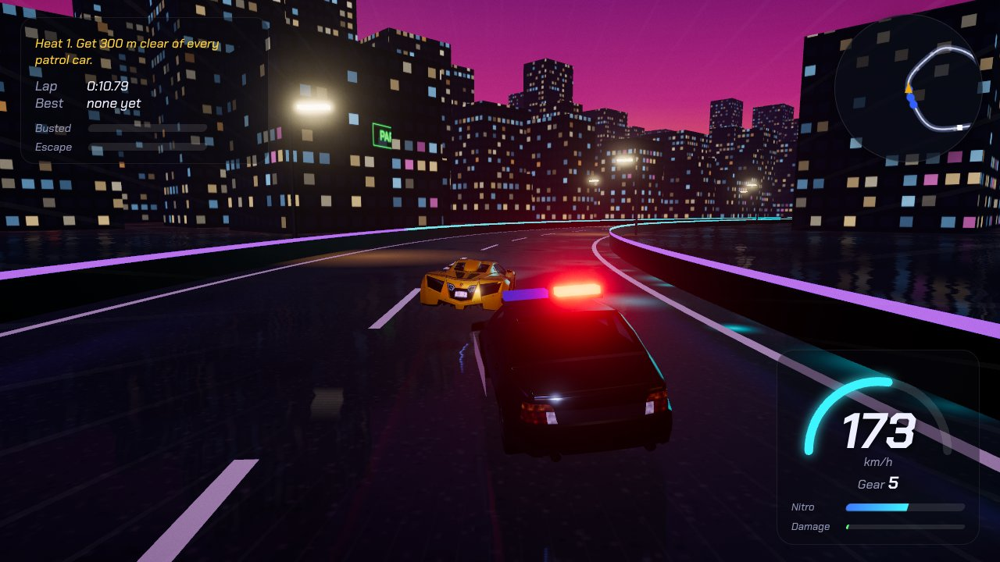
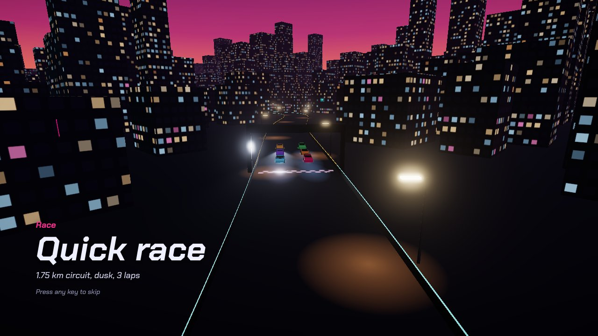
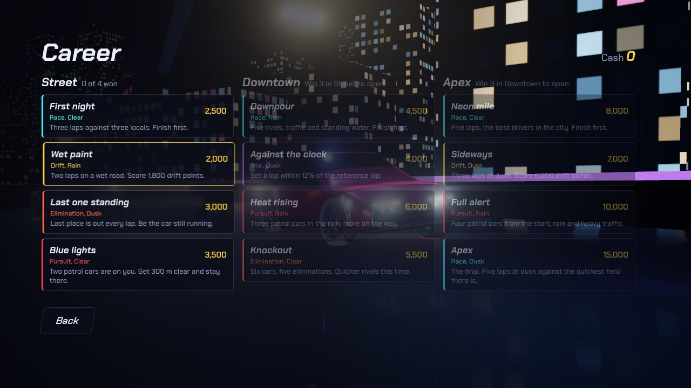
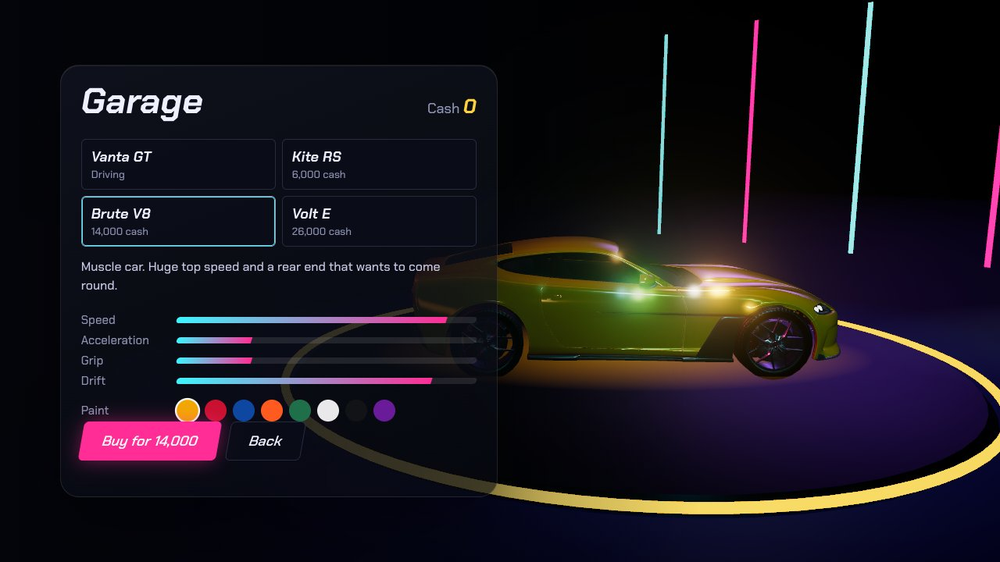
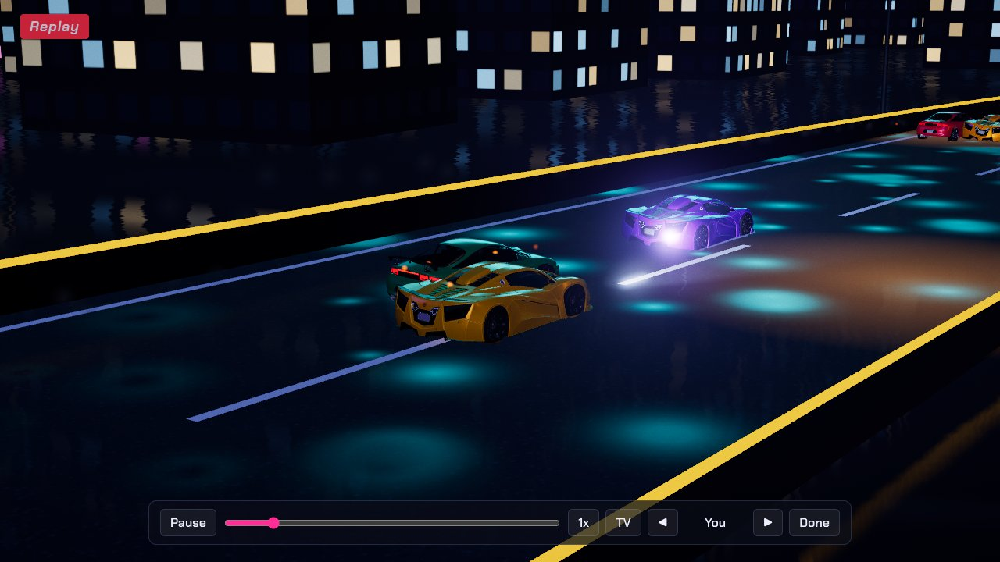
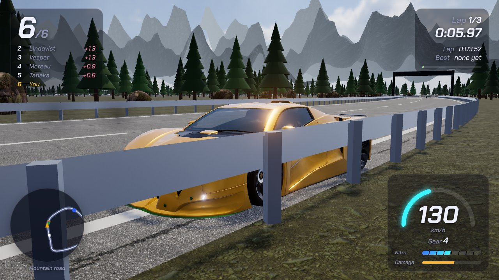
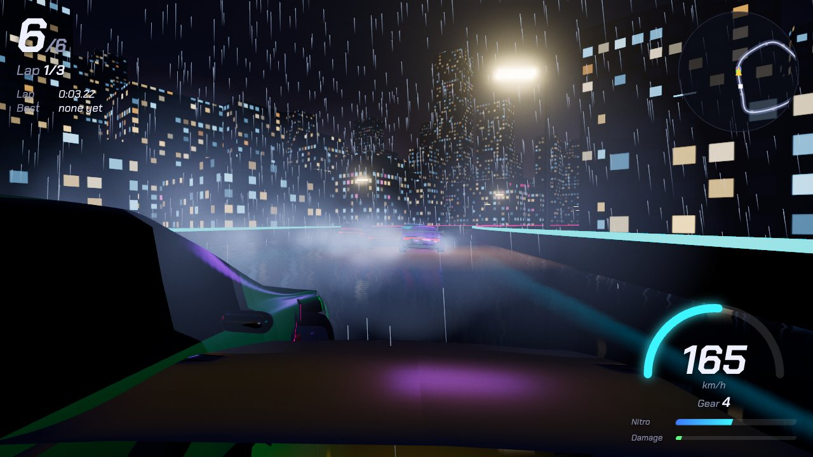

<p align="center">
  
</p>

<h1 align="center">Neon Apex</h1>

<p align="center">
  A night street racing game that runs in the browser.<br>
  A career, police chases, rain, traffic, and AI rivals that drive a racing line worked out from each track.
</p>

<p align="center">
  <a href="https://neon-apex-ten.vercel.app/"><b>Play it in your browser</b></a>
  &nbsp;&nbsp;
  <a href="https://neon-apex-ten.vercel.app/trailer.webm"><b>Watch the 31-second trailer</b></a>
</p>

<p align="center">
  <a href="https://github.com/EDWARD-012/neon-apex/actions/workflows/ci.yml"></a>
</p>

<p align="center">
  
</p>

You drive at night through a city built round a closed circuit. Drift to fill a nitro tank, burn it on the straights, thread through traffic for near misses, and get away from the police when they come after you. Hitting walls and other cars dents the bodywork where the hit landed, knocks mirrors and wings off and costs power. A career of twelve events across three tiers pays cash for wins, and the cash buys three more cars. There is also a new circuit every night, the same one for everyone, random tracks you can share by link, and a time trial against a ghost of your best lap.

It needs no install, no account and no server. It works with a keyboard, a gamepad or a touch screen.

The game is original. It borrows the street racing genre, not any particular game's cars, tracks, names or look, and no car is modelled on a real one.

## What is in it

<table>
  <tr>
    <td width="50%"></td>
    <td width="50%"></td>
  </tr>
  <tr>
    <td></td>
    <td></td>
  </tr>
  <tr>
    <td></td>
    <td></td>
  </tr>
  <tr>
    <td></td>
    <td></td>
  </tr>
  <tr>
    <td></td>
    <td></td>
  </tr>
</table>

Events. Races against five rivals. Elimination, where the last car is knocked out every time the leader finishes a lap. Drift events with a points target. Pursuits, where patrol cars chase you and you have to get 300 m clear of every one and stay there. Time trials against a ghost. Each one can be played on its own from Quick race, and the career strings twelve of them together.

Cars. Four, each the same physics with different numbers: a balanced coupe, a light hatch with sticky tyres, a muscle car that slides, and an electric car with instant pull and a long-lasting nitro tank. The garage shows each on a turntable with its ratings and lets you buy and paint them.

Each body is lofted from a handful of cross-sections along the car, with the wheel arches cut out of the sides, so the shapes are smooth rather than boxes. On top go a grille, splitter, diffuser, side skirts, mirrors, LED headlights, a full-width tail light, chrome exhaust tips on all but the electric car and, on some cars, a wing. Wheels are five-spoke rims in rounded tyres with brake calipers behind them. Every tyre and rim on the road is drawn by two instanced meshes, so the wheels of a full grid with traffic and police take two draw calls.

Damage. A hit on a barrier or another car at more than about 9 km/h is stored where it landed on the car. The body is pushed in around that point and the paint goes grey and scuffed, and the lights and grille move with the panel. Enough hits on one side tear off that side's mirror, enough on the back take the wing, and enough on the front puts a headlight out. Damage takes up to 30% of the engine's power and 12% of top speed, a badly damaged car trails smoke and then flames, and if your car is wrecked in a pursuit, you are busted.

Police. Patrol cars run the racing line slightly over the planned speed to close the gap, then aim for where you will be half a second ahead and try to ram. If you slow below about 20 km/h with one within 14 m, a busted meter fills. Every 40 seconds the heat rises and another patrol car joins, up to four.

Traffic. Civilian sedans and vans cruise in two lanes and slow down behind whatever is in front of them. Passing one fast and close without touching it is a near miss and tops up the nitro.

Weather. Clear night, rain or dusk. On high graphics the street is a real reflection of the city, smeared down the screen and rippled the way wet asphalt does it, and rain lets more of it through. Rain also brings falling rain, spray off the tyres, lightning and thunder. Tonight's track comes with tonight's weather.

Camera work. Five driving cameras: chase, far chase, bonnet, bumper and a drone view from high behind. Holding V looks back over the boot. Every race opens with a fly-in over the track, and the title screen cuts between tracking shots of a live race. A near miss or a big crash drops the game into slow motion for a moment. The finish slows down too, with the camera circling the car. Every race is recorded, and the replay can be watched from trackside TV cameras, a helicopter, the chase camera or the front bumper, at quarter, half, normal or double speed.

Nitro. Lighting it sends a ring of light out from the middle of the screen, kicks the field of view wider and pulls the camera back so the car seems to jump away, with blue flames from the exhausts and the tail light trails turning blue. Lifting off the throttle at speed makes the exhaust pop, except on the electric car. Pressing the throttle in the last half second before the light turns green, and not earlier, is a perfect start and adds nitro.

Look and sound. Bloom on everything that glows, light trails behind tail lights at speed, motion blur and colour fringing on nitro, tyre smoke, sparks, skid marks, a colour grade that cools the shadows and warms the highlights, and fine film grain. The skyline has scrolling billboards and searchlights sweeping the sky. Engine, tyres, nitro, exhaust pops, sirens, rain and thunder are all synthesised with the Web Audio API. The repo ships no audio files, and every world texture is drawn on a canvas at load time.

## How the AI drives

<p align="center">
  
</p>

Every track gets a racing line before the race starts, in [src/sim/line.ts](src/sim/line.ts).

The line is the path through the road that bends as little as possible. For a path at sideways offset d from a centre line with curvature k, the path's curvature is close to k − d″, so the code picks offsets that make the sum of (k − d″)² over the lap as small as it can, without letting the line come within 2.2 m of the edge of the road. That gives the usual shape: wide on the way into a corner, tight at the apex, wide again on the way out. It is solved by gradient descent, first on a copy of the track sampled every 8 m so the long sweeps settle quickly, then on every 2 m sample for the detail inside hairpins.

A speed profile goes with the line. Each point gets the highest speed at which the tyres can hold its curvature. A forward pass then caps every point at what the engine can reach from the point before it, and a backward pass caps it at what the brakes can shed before the point after. The time to drive that profile is the reference lap shown on the results screen.

The AI drivers steer by pure pursuit towards a point on the line a little way ahead, further ahead the faster they go, and use throttle and brake to hold the planned speed times a skill factor. When a car blocks the line close ahead, or is alongside one being passed, they take a side, keep it until the line is clear, and come back.

## Laps that cannot be faked

Lap counting does not trust where a car is on the map. Each car keeps a running total of how far it has travelled along the centre line, forwards minus backwards, and the lap is split into 16 checkpoints. A lap counts only when that total passes every checkpoint in order. Driving backwards over the finish line earns nothing and turns on the wrong-way warning, and a car that is moved straight across the infield gets no distance for the jump. Both cases are tests in [tests/race.test.ts](tests/race.test.ts).

## Numbers

`npm run stats` builds five tracks, runs a two-lap race on each with every car on the AI, and prints this table:

| Track | Length | Bend, centre line | Bend, racing line | Reference lap | Fastest AI lap |
| --- | --- | --- | --- | --- | --- |
| night-2026-11-18 | 1360 m | 0.230 | 0.161 (30% less) | 34.45 s | 35.69 s |
| readme | 1750 m | 0.046 | 0.038 (17% less) | 31.99 s | 33.13 s |
| random-K2Q7M | 1928 m | 0.255 | 0.190 (26% less) | 46.75 s | 50.22 s |
| random-7HX0P | 1542 m | 0.097 | 0.058 (40% less) | 32.29 s | 34.02 s |
| random-B4TAN | 1598 m | 0.159 | 0.106 (33% less) | 34.51 s | 37.28 s |

"Bend" is the sum of squared curvature times length over one lap, so lower means a smoother path. The reference lap comes from the speed profile, which treats the car as a point with a fixed grip limit. It is a target, not a proven best: the real car model has a little more grip than the profile plans with, so a good driver can beat it. `tests/readme.test.ts` reruns the script and fails if this table goes out of date.

## Controls

| Action | Keyboard | Gamepad | Touch |
| --- | --- | --- | --- |
| Accelerate, brake and reverse | Up, Down or W, S | Right and left triggers | Gas, Brake |
| Steer | Left, Right or A, D | Left stick | Arrow buttons |
| Drift | Space | B or right bumper | Drift |
| Nitro | Shift | A | Nitro |
| Reset onto the road | R | Y | |
| Change camera | C | X | |
| Look back, held | V or B | Left bumper | |
| Pause | Esc or P | Start | Pause button |

Any key or tap skips the fly-in before a race.

## Run it locally

Needs Node 22 or newer.

```bash
git clone https://github.com/EDWARD-012/neon-apex.git
cd neon-apex
npm ci
npm run dev
```

`npm run build` writes the static site to `dist/`.

## Tests

```bash
npm test
```

The unit tests check the simulation without drawing anything. Thirty seeded tracks are checked for even spacing, the corner-radius limit and no two parts of the road running into each other. Forty racing lines are checked to stay on the road and to bend less than their centre lines. The speed profile is checked against the grip, engine and brake limits at every point. The car tests cover top speed, nitro, braking into reverse, steering direction, the handbrake slide, barriers, determinism, nose-to-tail contact, and two cars passing side by side a metre apart without touching. The damage tests check that a barrier hit lands on the nose, that a light touch leaves no mark, that a shunt marks the front of one car and the back of the other, and that a wrecked car is slower than a fresh one. Six full races check that every AI car finishes within a set margin of the reference lap. The mode tests run an elimination race to its last car, get a stationary player busted and a fleeing one away, bust a wrecked car, check that police join as the heat rises, bank drift points from a handbrake slide, and count a close pass in traffic as one near miss and a rear-end shunt as none. Every car is driven round a full lap. The career tests check payouts, repeat wins, the targets for each kind of event, tier unlocking and buying cars.

```bash
npx playwright install
```

```bash
npm run e2e
```

The browser tests play the built game through its menus in Playwright's Chromium, Firefox and WebKit, and at a phone-sized landscape viewport with touch controls. They check that the city renders, that the car responds to the keyboard or the touch buttons, that a race with traffic runs to the results table and its replay plays and changes camera, that a time trial saves a ghost and shows it on the next run, that a pursuit puts police on the road with the meters showing, that pause freezes the race clock, that a random track's seed goes into the address bar, and that a career event pays cash which then buys a car in the garage. Any console error fails a test.

The game is hosted on Vercel, which builds and publishes every push to `main`. CI runs the unit tests and the browser tests on the same push, against the same commit. The old GitHub Pages address now forwards to Vercel, keeping any track seed in the link. CI runs every browser test except the Firefox ones: GitHub's machines have no graphics card, and headless Firefox finds no way to start WebGL there, so Firefox runs on a local machine only.

`npm run shots` retakes the screenshots and the GIF in this README by playing the game in a headless browser, `npm run trailer` records the trailer the same way, and `npm run diagram` redraws the racing line picture. The GIF step needs Python with Pillow, and the trailer needs a machine with a graphics card to record at full frame rate.

## Layout

```text
src/sim/        simulation, no three.js: tracks, racing line, cars, physics,
                AI, traffic, police, race rules for every kind of event
src/render/     three.js: city, track meshes, car models, garage, weather,
                particles, light trails, bloom and the speed blur pass
src/game.ts     game loop, cameras, HUD, ghosts, replays and race events
src/cinema.ts   fly-in, finish orbit and replay cameras
src/replay.ts   recording and playing back a race
src/career.ts   events, payouts, unlocks and saved progress
src/main.ts     menus, garage, career screen and settings
src/audio.ts    synthesised sound
src/input.ts    keyboard, gamepad and touch
tests/          unit tests for the simulation, the career and the README table
e2e/            browser tests
scripts/        stats table, diagram, screenshots, GIF and trailer
pages/          the page GitHub Pages serves, which forwards to Vercel
```

Dependencies are pinned to exact versions in `package.json` and `package-lock.json`.

## Limits

- Tracks are flat. There are no hills, jumps or bridges, and every event runs on a closed circuit.
- The physics is arcade physics on a plane: one velocity, one heading and a grip rule. Cars cannot roll or leave the ground, and contact between cars is two circles per car pushing apart.
- AI rivals never drift, and the police cannot turn round if they overshoot you; they slow down and wait instead.
- The car bodies are built from a few cross-sections each, not modelled by hand, and have no interiors, so the bonnet camera shows no dashboard.
- Damage changes how a car looks and how much power it has, not how it handles. Panels dent but never come off, apart from mirrors and wings, and the collision shape stays the same. Outside a pursuit a car cannot be written off.
- There is no multiplayer, and no shared leaderboard since there is no server. Career progress, ghosts and settings live in your browser's local storage.
- The browser tests run Playwright's builds of the three engines. WebKit is Safari's engine but it is not Safari, and the phone test is a phone-sized viewport on a desktop machine. Real phones and real Safari have not been tried.
- The trailer is WebM, which every current desktop browser plays. Some older Safari versions do not.
- Frame rate depends on the graphics card. The Low graphics setting turns off bloom, the speed blur and the street reflection and renders at normal pixel density, and touch screens start on it.

## Licence

MIT. See [LICENSE](LICENSE).
