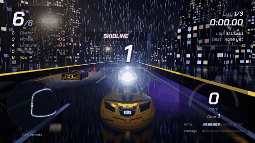
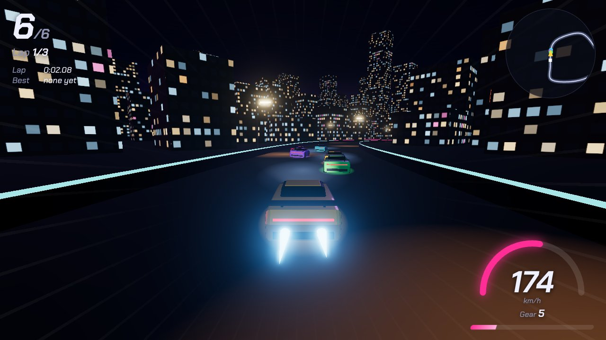
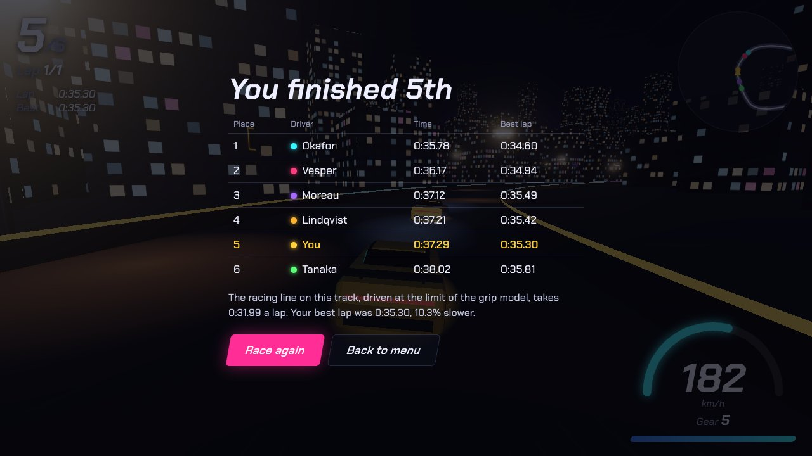

<p align="center">
  
</p>

<h1 align="center">Neon Apex</h1>

<p align="center">
  A night street racing game that runs in the browser.<br>
  Five AI rivals drive a racing line worked out from the shape of each track.
</p>

<p align="center">
  <a href="https://edward-012.github.io/neon-apex/"><b>Play it in your browser</b></a>
</p>

<p align="center">
  <a href="https://github.com/EDWARD-012/neon-apex/actions/workflows/ci.yml"></a>
</p>

<p align="center">
  
</p>

You race five AI cars round a city circuit at night: drift through the corners to fill a nitro tank, then burn it on the straights. There is a new circuit every night, the same one for everyone, plus random tracks and a time trial against a ghost of your best lap. It needs no install, no account and no server, and works with a keyboard, a gamepad or a touch screen.

The game is original. It borrows the street racing genre, not any particular game's cars, tracks or look, and no car is modelled on a real one.

## What is in it

<table>
  <tr>
    <td width="50%"></td>
    <td width="50%"></td>
  </tr>
  <tr>
    <td></td>
    <td></td>
  </tr>
</table>

- Arcade handling with a handbrake drift. Sliding fills the nitro tank, and a drift that ends cleanly banks points.
- Five AI rivals that follow a computed racing line, brake for corners from a planned speed profile and move off the line to pass a slower car.
- Circuits generated from a seed. Tonight's track is built from the date, so everyone gets the same one, and a random track can be shared by its link.
- Time trial: your best lap on each track is saved in the browser and replays as a ghost car.
- A city built at load time: towers with lit windows, neon signs facing the road, street lights, a gantry over the start line, and bloom over all of it.
- Engine, tyre squeal, nitro and crashes are synthesised with the Web Audio API, so the repo ships no audio files, and the textures are drawn on canvases at load time.
- A HUD with place, lap times, a speed gauge, nitro, and a minimap that turns with the car. There is a chase camera and a bonnet camera.

## How the AI drives

<p align="center">
  
</p>

Every track gets a racing line before the race starts, in [src/sim/line.ts](src/sim/line.ts).

The line is the path through the road that bends as little as possible. For a path at sideways offset d from a centre line with curvature k, the path's curvature is close to k − d″, so the code picks offsets that make the sum of (k − d″)² over the lap as small as it can, without letting the line come within 2.2 m of the edge of the road. That gives the usual shape: wide on the way into a corner, tight at the apex, wide again on the way out. It is solved by gradient descent, first on a copy of the track sampled every 8 m so the long sweeps settle quickly, then on every 2 m sample for the detail inside hairpins.

A speed profile goes with the line. Each point gets the highest speed at which the tyres can hold its curvature. A forward pass then caps every point at what the engine can reach from the point before it, and a backward pass caps it at what the brakes can shed before the point after. The time to drive that profile is the reference lap shown on the results screen.

The AI drivers steer by pure pursuit towards a point on the line a little way ahead, further ahead the faster they go, and use throttle and brake to hold the planned speed times a skill factor. When a slower car is close ahead in their lane they move a few metres to one side of the line and come back once past.

## Laps that cannot be faked

Lap counting does not trust where a car is on the map. Each car keeps a running total of how far it has travelled along the centre line, forwards minus backwards, and the lap is split into 16 checkpoints. A lap counts only when that total passes every checkpoint in order. Driving backwards over the finish line earns nothing and turns on the wrong-way warning, and a car that is moved straight across the infield gets no distance for the jump. Both cases are tests in [tests/race.test.ts](tests/race.test.ts).

## Numbers

`npm run stats` builds five tracks, runs a two-lap race on each with every car on the AI, and prints this table:

| Track | Length | Bend, centre line | Bend, racing line | Reference lap | Fastest AI lap |
| --- | --- | --- | --- | --- | --- |
| night-2026-11-18 | 1360 m | 0.230 | 0.161 (30% less) | 34.45 s | 35.65 s |
| readme | 1750 m | 0.046 | 0.038 (17% less) | 31.99 s | 33.13 s |
| random-K2Q7M | 1928 m | 0.255 | 0.190 (26% less) | 46.75 s | 49.13 s |
| random-7HX0P | 1542 m | 0.097 | 0.058 (40% less) | 32.29 s | 33.64 s |
| random-B4TAN | 1598 m | 0.159 | 0.106 (33% less) | 34.51 s | 35.95 s |

"Bend" is the sum of squared curvature times length over one lap, so lower means a smoother path. The reference lap comes from the speed profile, which treats the car as a point with a fixed grip limit. It is a target, not a proven best: the real car model has a little more grip than the profile plans with, so a good driver can beat it. `tests/readme.test.ts` reruns the script and fails if this table goes out of date.

## Controls

| Action | Keyboard | Gamepad | Touch |
| --- | --- | --- | --- |
| Accelerate, brake and reverse | Up, Down or W, S | Right and left triggers | Gas, Brake |
| Steer | Left, Right or A, D | Left stick | Arrow buttons |
| Drift | Space | B or right bumper | Drift |
| Nitro | Shift | A | Nitro |
| Reset onto the road | R | Y | |
| Change camera | C | X | |
| Pause | Esc or P | Start | Pause button |

## Run it locally

Needs Node 22 or newer.

```bash
git clone https://github.com/EDWARD-012/neon-apex.git
cd neon-apex
npm ci
npm run dev
```

`npm run build` writes the static site to `dist/`.

## Tests

```bash
npm test
```

The unit tests check the simulation without drawing anything. Thirty seeded tracks are checked for even spacing, the corner-radius limit and no two parts of the road running into each other. Forty racing lines are checked to stay on the road and to bend less than their centre lines. The speed profile is checked against the grip, engine and brake limits at every point. The car tests cover top speed, nitro, braking into reverse, steering direction, the handbrake slide, barriers and determinism. Six full races check that every AI car finishes within a set margin of the reference lap, and the race tests cover the countdown, standings and the two lap-cheating cases above.

```bash
npx playwright install
```

```bash
npm run e2e
```

The browser tests play the built game in Playwright's Chromium, Firefox and WebKit, and at a phone-sized landscape viewport with touch controls. They check that the city actually renders, that the car responds to the keyboard or the touch buttons, that a race runs through to the results table, that a time trial saves a ghost and shows it on the next run, that pause freezes the race clock, and that a random track's seed goes into the address bar. Any console error fails a test. CI runs all of it on every push and only publishes the site if everything passes.

`npm run shots` retakes the screenshots and the GIF in this README by playing the game in a headless browser, and `npm run diagram` redraws the racing line picture. The GIF step needs Python with Pillow.

## Layout

```text
src/sim/        simulation, no three.js: tracks, racing line, car physics, AI, race rules
src/render/     three.js: city, track meshes, car model, particles, bloom
src/game.ts     the game loop, camera, HUD, ghosts and race events
src/main.ts     menus and settings
src/audio.ts    synthesised sound
src/input.ts    keyboard, gamepad and touch
tests/          unit tests for the simulation and the README table
e2e/            browser tests
scripts/        stats table, diagram, screenshots and GIF
```

## Limits

- Tracks are flat. There are no hills, jumps or bridges.
- The physics is arcade physics on a plane: one velocity, one heading and a grip rule. Cars cannot roll or leave the ground, and contact between cars is two circles pushing apart.
- AI drivers never drift and they all follow the same line, so the field can bunch up behind a slow car before someone finds a gap.
- There is no multiplayer, and no shared leaderboard since there is no server. Ghosts and settings live in your browser's local storage.
- The browser tests run Playwright's builds of the three engines. WebKit is Safari's engine but it is not Safari, and the phone test is a phone-sized viewport on a desktop machine. Real phones and real Safari have not been tried.
- Frame rate depends on the graphics card. The Low graphics setting turns off bloom and renders at normal pixel density, and touch screens start on it.

## Licence

MIT. See [LICENSE](LICENSE).
