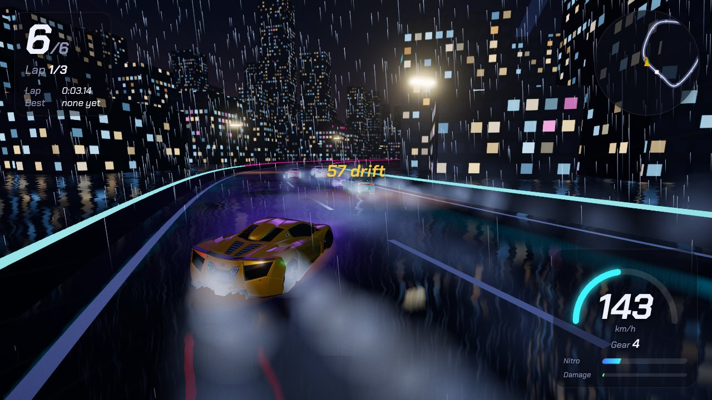
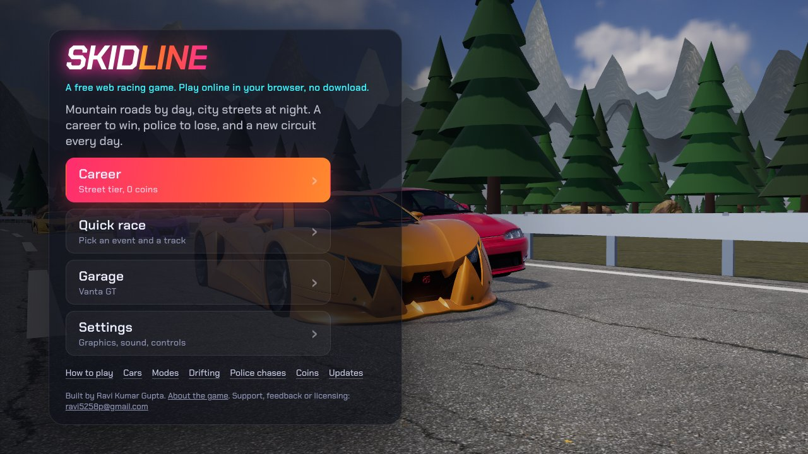
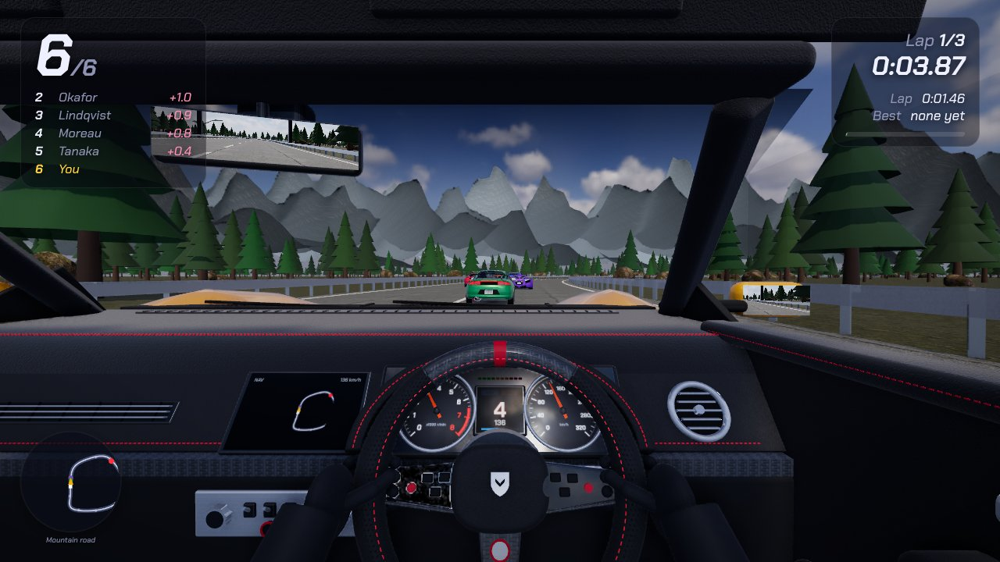
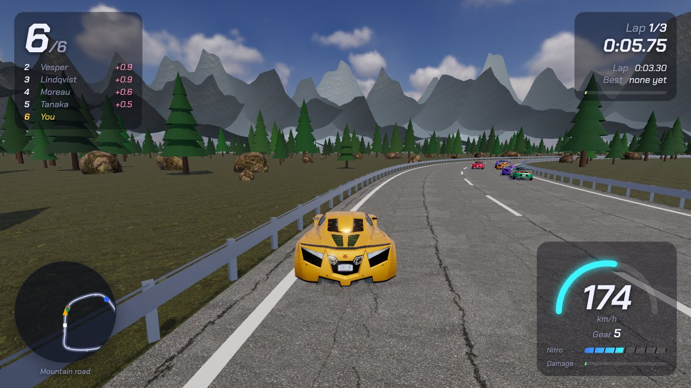
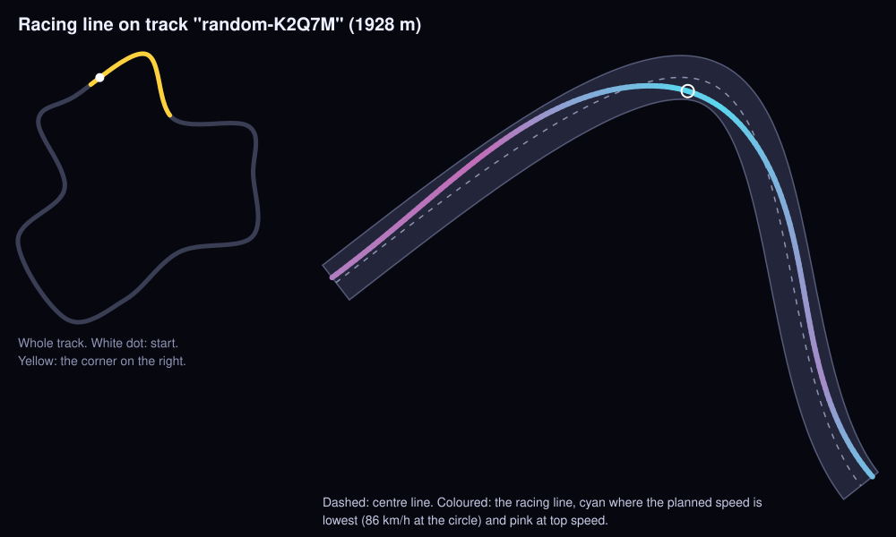

<p align="center">
  
</p>

<h1 align="center">Skidline</h1>

<p align="center"><sub>Called Neon Apex until 21 November 2026. The repository keeps that name, so old links still work.</sub></p>

<p align="center">
  A street racing game that runs in the browser, on a mountain road by day or in a neon city at night.<br>
  A career, police chases, crash damage, a cockpit view, and AI rivals that drive a racing line worked out from each track.
</p>

<p align="center">
  <a href="https://apex.edward7780.com/"><b>Play it in your browser</b></a>
  &nbsp;&nbsp;
  <a href="https://apex.edward7780.com/trailer.webm"><b>Watch the 31-second trailer</b></a>
</p>

<p align="center">
  <a href="https://github.com/EDWARD-012/neon-apex/actions/workflows/ci.yml"></a>
</p>

<p align="center">
  
</p>

You race round a closed circuit, either through a forested mountain valley in sunshine or through a city at night. Drift to fill a nitro tank, burn it on the straights, thread through traffic for near misses, and get away from the police when they come after you. Hitting walls and other cars dents the bodywork where the hit landed, knocks mirrors and wings off and costs power. A career of twelve events across three tiers pays coins for wins, and so does every quick race, along with near misses, drifts and clean laps. Coins buy three more cars and upgrades for each of them. There is also a new circuit every day, the same one for everyone, random tracks you can share by link, and a time trial against a ghost of your best lap.

It needs no install and works with a keyboard, a gamepad or a touch screen. An account is optional: signing in with Google keeps your coins, cars, upgrades and career on every device. On a phone held upright the game asks to be turned sideways, and on Android it goes full screen in landscape when a race starts.

The game is original. It borrows the street racing genre, not any particular game's cars, tracks, names or look, and no car is modelled on a real one.

## What is in it

<table>
  <tr>
    <td width="50%"></td>
    <td width="50%"></td>
  </tr>
  <tr>
    <td></td>
    <td></td>
  </tr>
  <tr>
    <td></td>
    <td></td>
  </tr>
  <tr>
    <td></td>
    <td></td>
  </tr>
  <tr>
    <td></td>
    <td></td>
  </tr>
  <tr>
    <td colspan="2"></td>
  </tr>
</table>

Events. Races against five rivals. Elimination, where the last car is knocked out every time the leader finishes a lap. Drift events with a points target. Pursuits, where patrol cars chase you and you have to get 300 m clear of every one and stay there. Time trials against a ghost. And playing the cop: you drive a police interceptor after four racers with a 3 second start, and bust them by ramming until their damage is full or by boxing them in, with a patrol car of backup every 30 seconds and two police tools (a roadblock or spike strip ahead of the leader, a helicopter that drops spikes in front of the leader, or a pulse that cuts a racer's power). Each one can be played on its own from Quick race, and the career strings twelve of them together as a ladder of three street crews. Win three of a crew's events to race its leader one on one, with upgrades fitted, and pick one of three reward cards the first time you win. Every career event has bronze, silver, gold and Skidline medals worth 500, 1,000, 2,000 and 5,000 coins once each, and rival cars carry more upgrades the higher you climb.

Cars. Five, each the same physics with different numbers: a balanced coupe, a light hatch with sticky tyres, a muscle car that slides, an electric car with instant pull and a long-lasting nitro tank, and a sports coupe with the sharpest turn-in. The garage shows each on a turntable with its ratings and lets you buy, upgrade and paint them.

Coins and upgrades. Every event pays coins. Career events pay their reward as before. A quick race pays 1,000 for a win, 500 for a podium and 200 for finishing over three laps, a third of that for one lap, and an escape from the police pays 1,000 for each heat level. On top of that each near miss pays 50, each lap without damage 100 and every 10 drift points 1, and a race won by under half a second pays a fifth more. The first run of the day on the daily track adds 1,000, plus 250 for each day in a row, up to 2,500. Getting busted pays nothing for that chase but takes nothing away. There is also a track for each week, the same for everyone, whose first finished run each week pays 1,000, and a daily challenge (win a quick race, 2,500 drift points, an escape at heat 2, 10 near misses, 3 busts as the cop, a clean race or an elimination podium) that pays 1,500 once a day. In the garage the coins buy upgrades: engine, gearbox, nitro, tyres, brakes, suspension, weight and armour, three stages each. A stage changes the car's numbers in the physics, so a stage 3 engine takes the Vanta GT from 259 to 290 km/h, and armour cuts the damage from every hit. Prices are a share of the car's price, with the free starter car priced as if it cost 10,000, and the bars show what the next stage adds, or costs, before you buy it. Each car has a class by its top speed with its upgrades counted (S from 295 km/h, A from 270, B from 245, C from 220, D below), so a stage 3 engine lifts the Vanta GT from B to A, and a rating from 100 to 999 that weighs top speed, pull, grip and braking. A Looks tab sells paint finishes (matte 1,500, pearl 3,000, chrome 6,000) and underglow colours (1,500 each), each bought once and then free on every car.

The five cars you can drive are 3D models made by artists and shared on Sketchfab under CC BY 4.0, listed under Credits: a mid-engined hypercar for the Vanta GT and the Volt E, a light coupe for the Kite RS, a long-nosed GT for the Brute V8, and the traffic pack's sports car for the Kestrel S. The pack cars came painted, so the game finds the commonest strong colour in the Kestrel's body texture and repaints those texels in your colour. None is modelled on a real make. `npm run cars` turns the downloaded files into the small ones the game loads: it drops the baked ground shadows and the hidden engine bay, converts an old material format, compresses the meshes and shrinks the textures to 1024 px, about 2.8 MB for the three and 1.6 MB for the traffic pack. In the game each model is scaled to size, its wheels are found by name and put on pivots so they spin and steer, and the body is repainted in the colour you pick; on the textured bodies only the texels in the paint's hue change, so trim, grilles and dirt stay as the artist made them. Paint is a metallic base under a clear coat that reflects the sky. Traffic is ten everyday cars from one more CC BY pack (a sedan, compact, coupe, hatchback, wagon, sports car, minivan, SUV, off-roader and pickup), shown in the colours they came in; the pack has them all on one stand, so the game lifts each one out with the wheels beside it and turns it nose forward. The police drive the pack's sedan in dark paint with white doors, a light bar and a push bar. The ghost in a time trial is still a car drawn in code, lofted from a handful of cross-sections with the wheel arches cut out.

Damage. A hit on a barrier or another car at more than about 9 km/h is stored where it landed on the car, and the body panels are pushed in around that point. On the drawn cars the paint also goes grey and scuffed, the lights and grille move with the panel, enough hits on one side tear off that side's mirror, enough on the back take the wing, and enough on the front puts a headlight out. Damage takes up to 30% of the engine's power, 12% of top speed and a fifth of the grip, and a badly damaged car trails smoke and then flames. At full damage your car is wrecked: it goes up in a burst of fire and is out of the race, or busted in a pursuit. Rivals take damage too but are never wrecked.

Police. Patrol cars run the racing line slightly over the planned speed to close the gap, then aim for where you will be half a second ahead and try to ram. If you slow below about 20 km/h with one within 14 m, a busted meter fills, and a warning says you are being boxed in. Every 40 seconds the heat rises a level, up to five, and each level brings its own units: a pair of patrol cars at heat 2, one of them a blocker that drives past you and slows in your path; a heavy unit at heat 3, twice the weight of a patrol car and hard to hurt; another blocker at 4, called in ahead of you, and a helicopter whose searchlight slows the escape meter to about a third while it is within 120 m (it flies at about 210 km/h, so a fast car can outrun it); and two interceptors at 5, quicker than any stock car, which lock on from behind within 70 m and after a second and a half fire a pulse that cuts your power to 15% for 1.4 seconds. At most seven police cars chase at once. From heat 3 in a pursuit the police also set up out of sight ahead, every 22 seconds: a roadblock of two heavy units parked across the road with a gap of nearly 6 m on one side, then a spike strip over half the road. From heat 4 the gap can be spiked too. Spikes take about 28% off the top speed and 38% off the grip for the rest of the chase. Before a pursuit you pick two racer tools, and each works twice: a jammer that hides you from the helicopter and the interceptors' lock and stops roadblocks and spikes going up for 8 seconds; a shockwave that throws every car within 18 m away from you, which counts as your hit if a police car then meets a wall; a turbo, a push for 2.5 seconds to a quarter past top speed; and a mine dropped behind you that goes off under the first police car to reach it. Weight counts in every hit: a heavier car is pushed less and takes less of the knock. Races and eliminations have police too: a patrol car waits at the edge of the road, outside the traffic lanes, and gives chase if you pass within 30 m at more than 108 km/h. A crash brings them too: a hard ram into traffic or a wall hit that does real damage sends a patrol car in from about 220 m behind, out of sight, and during a chase each crash brings the next heat level 15 seconds sooner. Busted ends your race. Getting 300 m clear for six seconds loses them, pays 1,000 coins for each heat level, and sends them back to wait further round the lap. Every career race and elimination has police, one to three cars by tier, and quick races have a switch for them.
Effects. Chevron signs stand on the outside of every sharp corner, three to a corner, worked out from the track's curvature. In the rain, puddles lie on the road (the same ones for everyone on a track) and throw spray when a car drives through. Brakes glow orange after hard braking at speed and cool over a few seconds, hard hits throw glass and trim along with the sparks, a badly damaged car smokes and a wrecked one burns, and at night a patrol car's light bar washes the road red and blue. Splashes and debris are thinner on Low graphics.

Police. Patrol cars run the racing line slightly over the planned speed to close the gap, then aim for where you will be half a second ahead and try to ram. If you slow below about 20 km/h with one within 14 m, a busted meter fills, and a warning says you are being boxed in. Every 40 seconds the heat rises a level, up to five, and each level brings its own units: a pair of patrol cars at heat 2, one of them a blocker that drives past you and slows in your path; a heavy unit at heat 3, twice the weight of a patrol car and hard to hurt; another blocker at 4, called in ahead of you, and a helicopter whose searchlight slows the escape meter to about a third while it is within 120 m (it flies at about 210 km/h, so a fast car can outrun it); and two interceptors at 5, quicker than any stock car, which lock on from behind within 70 m and after a second and a half fire a pulse that cuts your power to 15% for 1.4 seconds. At most seven police cars chase at once. From heat 3 in a pursuit the police also set up out of sight ahead, every 22 seconds: a roadblock of two heavy units parked across the road with a gap of nearly 6 m on one side, then a spike strip over half the road. From heat 4 the gap can be spiked too. Spikes take about 28% off the top speed and 38% off the grip for the rest of the chase. Before a pursuit you pick two racer tools, and each works twice: a jammer that hides you from the helicopter and the interceptors' lock and stops roadblocks and spikes going up for 8 seconds; a shockwave that throws every car within 18 m away from you, which counts as your hit if a police car then meets a wall; a turbo, a push for 2.5 seconds to a quarter past top speed; and a mine dropped behind you that goes off under the first police car to reach it. Weight counts in every hit: a heavier car is pushed less and takes less of the knock. Races and eliminations have police too: a patrol car waits at the edge of the road, outside the traffic lanes, and gives chase if you pass within 30 m at more than 108 km/h. Busted ends your race. Getting 300 m clear for six seconds loses them, pays 1,000 coins for each heat level, and sends them back to wait further round the lap. Every career race and elimination has police, one to three cars by tier, and quick races have a switch for them.

Traffic. Civilian sedans and vans cruise in two lanes and slow down behind whatever is in front of them. Passing one fast and close without touching it is a near miss and tops up the nitro.

Race screen. Your place and the cars round you, each with the gap in seconds at your speed, sit at the top left; the race time, lap times and a progress bar at the top right; a map that turns with the car at the bottom left; and the speed, gear, nitro in eight segments and damage at the bottom right. Phones keep the map at the top right, clear of the touch buttons, and list only the nearest rivals.

Setting and weather. Day is a mountain road: the circuit runs through a valley of conifers and boulders under a ring of rocky, snow-capped peaks generated from the track's seed, with steel guard rails, a photographed sky that also lights the reflections on the cars, and a sun that casts shadows. Night is the city in clear weather, rain or at dusk. On high graphics the night street is a real reflection of the city, smeared down the screen and rippled the way wet asphalt does it, and rain lets more of it through. Rain also brings falling rain, spray off the tyres, lightning and thunder.

Camera work. Six driving cameras: chase, far chase, cockpit, bonnet, bumper and a drone view from high behind. The cockpit puts you in the driver's seat of a right-hand-drive interior with a dashboard, an instrument screen showing revs, speed, gear and nitro, and a steering wheel that turns with the front wheels. In the cockpit, bonnet and bumper views a small panel shows the brake and gas pedals and the wheel as you work them. Holding V looks back over the boot. Every race opens with a fly-in over the track, and the title screen cuts between tracking shots of a live race. A near miss or a big crash drops the game into slow motion for a moment. The finish slows down too, with the camera circling the car. Every race is recorded, and the replay can be watched from trackside TV cameras, a helicopter, the chase camera or the front bumper, at quarter, half, normal or double speed.

Nitro. Lighting it sends a ring of light out from the middle of the screen, kicks the field of view wider and pulls the camera back so the car seems to jump away, with blue flames from the exhausts and the tail light trails turning blue. Lifting off the throttle at speed makes the exhaust pop, except on the electric car. Pressing the throttle in the last half second before the light turns green, and not earlier, is a perfect start and adds nitro.

Look and sound. Bloom on everything that glows, light trails behind tail lights at speed, motion blur and colour fringing on nitro, tyre smoke, sparks, skid marks, a colour grade that cools the shadows and warms the highlights, and fine film grain. The skyline has scrolling billboards and searchlights sweeping the sky. Engine, tyres, nitro, exhaust pops, sirens, rain and thunder are all synthesised with the Web Audio API, along with wind that rises with speed, a rush of air as a car goes past close by, a siren that bends in pitch as a patrol car closes or drops back, a pop on each upshift under power and a turbo flutter when the throttle snaps shut, and each car has its own engine: a high twelve-cylinder, a turbo four with a whistle, a lumpy V8 and an electric motor's whine. The repo ships no audio files. The night city's textures are drawn on a canvas at load time; the daytime sky, road, rock and ground are CC0 photo textures from Poly Haven, listed under Credits.

## How the cars handle

Steering and grip use a two-axle tyre model in [src/sim/car.ts](src/sim/car.ts). Each axle's tyres make a sideways force from their slip angle, the angle between where the wheel points and where it is actually going. The force follows a tyre curve that peaks at about six degrees of slip and then falls away a little, and it is capped by friction times the load on that axle. Braking moves load onto the front tyres and accelerating onto the rear. The rear tyres are slightly stiffer than the front, so at the limit a car pushes wide rather than spinning.

For the player there is also an arcade drift, the kind street racing games use: at speed with the wheel turned hard, a tap of the brake (or the handbrake) throws the tail out, and from then on the drift is flown rather than simulated tyre by tyre. Steering into the corner deepens the angle to about 40 degrees and tightens the line, countersteering brings it down, the throttle holds the speed, and straightening the wheel for a moment ends it. The AI drives without it. Without the drift, the handbrake locks the rear wheels, which leaves them little sideways grip, and that starts a slide. Full throttle with the wheel turned keeps the rear wheels spinning and the slide going; let off or straighten up and the grip comes back. Two assists are there as in most racing games: a drift assist damps a slide past about 30 degrees so a held drift does not turn into a spin, and stability control nudges the car's rotation towards what the steering asks for whenever no handbrake slide is going. The tests check that a car corners at the tyres' grip limit and that a held drift lasts two seconds without spinning.

Holding a drift charges a boost. After one second the sparks off the back wheels turn blue, after three they turn pink, and straightening up then gives a push of 0.6 or 1.2 seconds on top of the engine, a little past the normal top speed. A hard hit during the drift loses the charge. Barriers are kinder than they were: a glancing touch turns the car to run along the wall and keeps nearly all its speed, and only a hit straight into the wall stops it. Shoving a rival or a patrol car into a wall at more than about 45 km/h, within a second and a half of hitting it, wrecks it: a takedown, worth 300 coins for a rival and 500 for each heat level for a patrol car.

## How the AI drives

<p align="center">
  
</p>

Every track gets a racing line before the race starts, in [src/sim/line.ts](src/sim/line.ts).

The line is the path through the road that bends as little as possible. For a path at sideways offset d from a centre line with curvature k, the path's curvature is close to k − d″, so the code picks offsets that make the sum of (k − d″)² over the lap as small as it can, without letting the line come within 2.2 m of the edge of the road. That gives the usual shape: wide on the way into a corner, tight at the apex, wide again on the way out. It is solved by gradient descent, first on a copy of the track sampled every 8 m so the long sweeps settle quickly, then on every 2 m sample for the detail inside hairpins.

A speed profile goes with the line. Each point gets the highest speed at which the tyres can hold its curvature. A forward pass then caps every point at what the engine can reach from the point before it, and a backward pass caps it at what the brakes can shed before the point after. The time to drive that profile is the reference lap shown on the results screen.

The AI drivers steer by pure pursuit towards a point on the line a little way ahead, further ahead the faster they go, and use throttle and brake to hold the planned speed times a skill factor. When a car blocks the line close ahead, or is alongside one being passed, they take a side, keep it until the line is clear, and come back.

## Laps that cannot be faked

Lap counting does not trust where a car is on the map. Each car keeps a running total of how far it has travelled along the centre line, forwards minus backwards, and the lap is split into 16 checkpoints. A lap counts only when that total passes every checkpoint in order. Driving backwards over the finish line earns nothing and turns on the wrong-way warning, and a car that is moved straight across the infield gets no distance for the jump. Both cases are tests in [tests/race.test.ts](tests/race.test.ts).

## Numbers

`npm run stats` builds five tracks, runs a two-lap race on each with every car on the AI, and prints this table:

| Track | Length | Bend, centre line | Bend, racing line | Reference lap | Fastest AI lap |
| --- | --- | --- | --- | --- | --- |
| night-2026-11-18 | 1360 m | 0.230 | 0.161 (30% less) | 34.45 s | 35.49 s |
| readme | 1750 m | 0.046 | 0.038 (17% less) | 31.99 s | 33.09 s |
| random-K2Q7M | 1928 m | 0.255 | 0.190 (26% less) | 46.75 s | 48.94 s |
| random-7HX0P | 1542 m | 0.097 | 0.058 (40% less) | 32.29 s | 34.14 s |
| random-B4TAN | 1598 m | 0.159 | 0.106 (33% less) | 34.51 s | 36.64 s |

"Bend" is the sum of squared curvature times length over one lap, so lower means a smoother path. The reference lap comes from the speed profile, which treats the car as a point with a fixed grip limit. It is a target, not a proven best: the real car model has a little more grip than the profile plans with, so a good driver can beat it. `tests/readme.test.ts` reruns the script and fails if this table goes out of date.

## Controls

| Action | Keyboard | Gamepad | Touch |
| --- | --- | --- | --- |
| Accelerate, brake and reverse | Up, Down or W, S | Right and left triggers | Gas, Brake |
| Steer | Left, Right or A, D | Left stick | Arrow buttons |
| Drift | Tap Down while steering, or Space | Tap left trigger while steering, or B / right bumper | Drift |
| Nitro | Shift | A | Nitro |
| Reset onto the road | R | Y | |
| Change camera | C | X | Camera button |
| Look back, held | V or B | Left bumper | |
| Pursuit tools 1 and 2 | 1 and 2, or Q and E | D-pad left and right | Tool buttons |
| Pause | Esc or P | Start | Pause button |
| Restart the event | T | Back / Select | |

Any key or tap skips the fly-in before a race.

Settings has three driving aids. Drift assist is the brake-tap drift and is on by default. Braking assist, off by default, brakes for you when the car is going more than 8% faster than the racing line's speed about a second ahead. Stability control is on by default; turning it off leaves the raw tyre model, without the nudge towards the steering and without the damping that keeps a held drift from spinning. Ghosts are saved with a handling version, so a change to the physics drops old ones rather than racing them against new handling.

## Accounts and saves

Progress always lives in the browser's local storage. Signing in also keeps it on a server, so it follows you to another device. The first sign-in is with Google; the game then asks you to choose a username and a password, and after that you can sign in with those on a computer where you are not signed in to Google.

The server is a set of Vercel functions in [api/](api) with a Neon Postgres database behind them. A Google sign-in is checked against Google's published keys for this app's client ID, a verified email address is required, and the session is a signed, HTTP-only cookie that lasts 90 days. Passwords are stored as salted scrypt hashes. A save is checked for shape and size before it is stored. When you sign in on a device, the account's save replaces the one on that device; an account with no save yet takes the device's progress. What is stored is listed on the [privacy page](https://apex.edward7780.com/privacy.html).

The game also sends a few anonymous play events to [api/event.ts](api/event.ts): when it is opened, when a race starts and ends, and a ping for each minute of play, each with a random ID made in the browser and no account, name or email. The server keeps only known fields and drops anything else. `npm run analytics` prints them day by day from the database in `.env.local`: visitors, sessions, minutes a session, races started and finished, and how many of a day's visitors came back the next day. Events are off in the browser tests and on localhost.

## Run it locally

Needs Node 22 or newer.

```bash
git clone https://github.com/EDWARD-012/neon-apex.git
cd neon-apex
npm ci
npm run dev
```

`npm run build` writes the static site to `dist/`. `npm run dev` runs the game without the account server, so signing in fails there; `vercel dev` runs both, given the project's environment variables (`DATABASE_URL` and `SESSION_SECRET`).

## Tests

```bash
npm test
```

The unit tests check the simulation without drawing anything. Thirty seeded tracks are checked for even spacing, the corner-radius limit and no two parts of the road running into each other. Forty racing lines are checked to stay on the road and to bend less than their centre lines. The speed profile is checked against the grip, engine and brake limits at every point. The car tests cover top speed, nitro, braking into reverse, steering direction, the handbrake slide, barriers, determinism, nose-to-tail contact, and two cars passing side by side a metre apart without touching. Two more check the tyre model: a car at full lock corners at the tyres' grip limit, give or take 15%, and a handbrake drift held on throttle and countersteer lasts more than two seconds without the car spinning. The damage tests check that a barrier hit lands on the nose, that a light touch leaves no mark, that a shunt marks the front of one car and the back of the other, and that a wrecked car is slower than a fresh one. Six full races check that every AI car finishes within a set margin of the reference lap. The pursuit tests check that each heat level brings its own units, that a race never has more police after the player than its limit, that a heavy unit moves half as much as the patrol car it hits, and that a blocker just ahead slows in the player's path. The police tests check that a waiting patrol car sits outside the traffic lanes, chases a car that passes fast and ignores a slow one, busts a stopped player and ends the race, and goes back to waiting when the player gets clear. The wreck tests check that full damage puts the player out but leaves the car on the road, and that rivals and the title screen's car are never wrecked by damage alone. The feel tests check that a drift held under a second gives no boost, one held past one second a small one and past three seconds a big one, that the boost makes the car faster, that a glancing wall touch keeps most of the speed while a head-on hit stops the car, and that shoving a rival or a patrol car into a wall wrecks it while a car hitting a wall on its own is left alone. Two more check that braking assist brakes when the car is too fast for the road ahead and leaves it alone otherwise, and that with stability control off a car that starts to rotate keeps rotating for longer. The mode tests run an elimination race to its last car, get a stationary player busted and a fleeing one away, bust a wrecked car, check that police join as the heat rises, bank drift points from a handbrake slide, and count a close pass in traffic as one near miss and a rear-end shunt as none. Every car is driven round a full lap. The career tests check payouts, repeat wins, the targets for each kind of event, tier unlocking and buying cars. The upgrade tests check each car's top speed at every engine stage, that a tuned engine is faster in the physics and armour takes less damage from the same wall, that stages are bought in order and only with enough coins, and the coin pay for places, skills, close wins, the daily streak and a busted chase. Two race tests count laps driven without damage. The analytics tests check that the event endpoint keeps a well-formed event, refuses bad IDs and unknown event names, and keeps only the known details, trimmed. The account tests check username rules, password length, that passwords are stored salted and hashed and checked correctly, and that the server refuses saves of the wrong shape or size.

```bash
npx playwright install
```

```bash
npm run e2e
```

The browser tests play the built game through its menus in Playwright's Chromium, Firefox and WebKit, and at a phone-sized landscape viewport with touch controls. They check that the city renders, that the car responds to the keyboard or the touch buttons, that a race with traffic runs to the results table and its replay plays and changes camera, that a time trial saves a ghost and shows it on the next run, that a pursuit puts police on the road with the meters showing, that a patrol car waits by the road in a race and chases a car that flies past, that the race screen shows the standings with gaps, the time, the map and the speed, that the driving aids in Settings are kept and used in the race, that pause freezes the race clock, that a random track's seed goes into the address bar, that a career event pays coins which then buy a car and an engine upgrade in the garage, and that the next race is driven with that engine, and, on the phone, that holding it upright brings up the turn-sideways screen and pauses the race. Any console error fails a test.

The game is hosted on Vercel at apex.edward7780.com, and Vercel builds and publishes every push to `main`. CI runs the unit tests and the browser tests on the same push, against the same commit. The old GitHub Pages address now forwards to Vercel, keeping any track seed in the link. CI runs every browser test except the Firefox ones: GitHub's machines have no graphics card, and headless Firefox finds no way to start WebGL there, so Firefox runs on a local machine only.

`npm run shots` retakes the screenshots and the GIF in this README by playing the game in a headless browser, `npm run trailer` records the trailer the same way, and `npm run diagram` redraws the racing line picture. The GIF step needs Python with Pillow, and the trailer needs a machine with a graphics card to record at full frame rate.

## Layout

```text
src/sim/        simulation, no three.js: tracks, racing line, cars, physics,
                AI, traffic, police, race rules for every kind of event
src/render/     three.js: city, track meshes, car models, garage, weather,
                particles, light trails, bloom and the speed blur pass
src/game.ts     game loop, cameras, HUD, ghosts, replays and race events
src/cinema.ts   fly-in, finish orbit and replay cameras
src/replay.ts   recording and playing back a race
src/career.ts   events, coin payouts, unlocks and saved progress
src/upgrades.ts parts, stages, prices and the tuned car spec
src/main.ts     menus, garage, career screen and settings
src/audio.ts    synthesised sound
src/input.ts    keyboard, gamepad and touch
tests/          unit tests for the simulation, the career and the README table
e2e/            browser tests
scripts/        stats table, diagram, screenshots, GIF, trailer, car models
pages/          the page GitHub Pages serves, which forwards to Vercel
api/            account and save endpoints (Vercel functions)
public/textures/  daytime sky and photo textures from Poly Haven
public/models/  the compressed car models
```

Dependencies are pinned to exact versions in `package.json` and `package-lock.json`.

## Limits

- Tracks are flat. There are no hills, jumps or bridges, and every event runs on a closed circuit. The mountains are scenery only.
- The trees and the mountains are generated in code, not modelled by an artist, so up close they look like game models rather than photographs. The cars are artists' models, but their dents do not tear panels or break glass, and traffic cars do not light their brake lights.
- The physics is arcade physics on a plane: one velocity, one heading and a grip rule. Cars cannot roll or leave the ground, and contact between cars is two circles per car pushing apart.
- AI rivals never drift, and the police cannot turn round if they overshoot you; they slow down and wait instead.
- The car bodies are built from a few cross-sections each, not modelled by hand, and have no interiors, so the bonnet camera shows no dashboard.
- Damage changes how a car looks and how much power it has, not how it handles. Panels dent but never come off, apart from mirrors and wings, and the collision shape stays the same. Outside a pursuit a car cannot be written off.
- There is no multiplayer and no shared leaderboard. Ghosts and settings stay in your browser; only the career save goes to your account. There is no password reset, because the game sends no email.
- The browser tests run Playwright's builds of the three engines. WebKit is Safari's engine but it is not Safari, and the phone test is a phone-sized viewport on a desktop machine. Real phones and real Safari have not been tried.
- The trailer is WebM, which every current desktop browser plays. Some older Safari versions do not.
- Frame rate depends on the graphics card. The Low graphics setting turns off bloom, the speed blur and the street reflection and renders at normal pixel density, and touch screens start on it.

## Credits

Car models, all CC BY 4.0, from Sketchfab: [Fictional supercar - V12 Goblin](https://sketchfab.com/3d-models/fictional-supercar-v12-goblin-0a20e49ad5774d778567cb5c3f345786) by ollitei, [Generic Coupe "Azura"](https://sketchfab.com/3d-models/generic-coupe-azura-2e1a3699de7e4f688d328dc005ef1aac) by mk2design and [Generic Sport Coupé Car](https://sketchfab.com/3d-models/generic-sport-coupe-car-820a13c4831c41959ce75e6c2014e882) by MMC Works, and the [Generic passenger car pack](https://sketchfab.com/3d-models/generic-passenger-car-pack-20f9af9b8a404d5cb022ac6fe87f21f5) by Comrade1280 for traffic and the police. They are modified by `scripts/prepare-cars.mjs` as described under Cars, and the game repaints them. The original downloads are not in the repo; put them in `assets-src/cars` to rebuild.

The daytime sky and the road, rock and ground textures are from [Poly Haven](https://polyhaven.com), released under CC0: "Kloofendal 48d Partly Cloudy (Pure Sky)" by Greg Zaal and Jarod Guest, "Asphalt 02", "Aerial Rocks 02" and "Forest Ground 04". They are resized and recompressed in `public/textures`.

## Contact and support

Skidline is free to play. To support it, to report something, to ask about a licence or to buy the source code, write to [ravi5258p@gmail.com](mailto:ravi5258p@gmail.com).

## Licence

All rights reserved. The code is public to read, but not to use, copy, change or sell without written permission; see [LICENSE](LICENSE). Versions up to and including commit 4ece86d (20 November 2026) were released under the MIT License, and copies already made of those stay under it. The car models and textures keep their own licences, listed under Credits.
